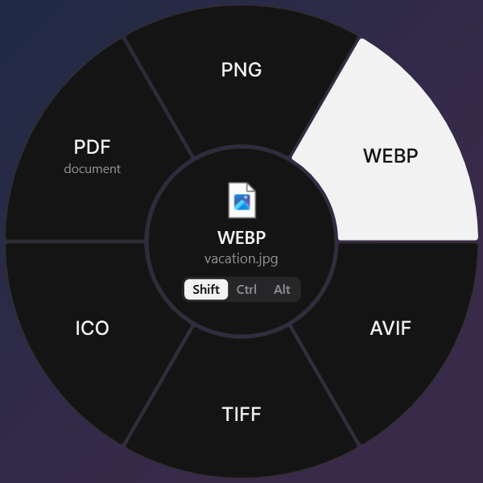
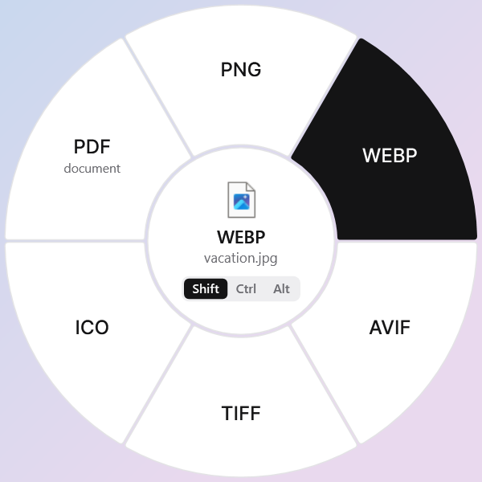

# Forma 1.2

Раньше называлась Sweetch. С версии 1.2.1 Forma — отдельное приложение: свои папки, автозапуск и пункт меню, ставится в `Programs\Forma`. Её можно держать рядом с оригинальным Sweetch, но на Shift тогда откроются оба кольца. При обновлении с 1.2.0 Forma переносит свои настройки и удаляет только свою прежнюю установку.

Файловый конвертер для Windows с круговым меню. Автор проекта Forma: [@mmmorozov](https://t.me/mmmorozov).

## Скачать программу для Windows

| Вариант | Скачать | Как запустить |
| --- | --- | --- |
| **Установщик EXE** | [Forma — установить](https://github.com/fggtf24-cyber/Sweetch/releases/latest/download/Forma-Setup.exe) (`Forma-Setup.exe`, всегда последняя версия) | Запустите установщик. Он добавит программу в меню «Пуск», включит запуск вместе с Windows и позволит удалить её через настройки Windows. |
| **Архив ZIP без установки** | [Forma — скачать архив](https://github.com/fggtf24-cyber/Sweetch/releases/latest) | Распакуйте всю папку и запустите `Sweetch.exe`. |

Оба варианта содержат готовую программу, .NET, Pandoc и FFmpeg. Нужна Windows 10 (1809+) или Windows 11, x64. [Все файлы релиза и контрольные суммы SHA-256](https://github.com/fggtf24-cyber/Sweetch/releases/latest). Пункты **Source code** и кнопка **Code → Download ZIP** предназначены для разработчиков и содержат исходники.

<p align="center">
  
  
</p>

Перетащите файл в Проводнике или на рабочем столе и нажмите **Shift** для конвертации, **Ctrl** для инструментов или **Alt** для действий. Отпустите файл над нужным сектором. Для работы без мыши выберите файлы в Проводнике и нажмите **Ctrl + Alt + Space**. В играх и других программах меню не появляется.

## Запуск

Установите программу через EXE или распакуйте весь архив ZIP и запустите `Sweetch.exe`. Программа находится в области уведомлений рядом с часами; двойной щелчок открывает настройки.

Язык: **Как в системе / Русский / English**. Для остальных языков системы используется английский. Оформление: **Как в системе / Тёмная / Светлая**. Оформление минималистичное: плоские чёрно-белые поверхности с тонкими линиями, без прозрачности, размытия и теней.

Настройки хранятся в `%APPDATA%\Forma`, загружаемые инструменты — в `%LOCALAPPDATA%\Forma\tools`. Скриншоты и виртуальные вложения сохраняются в `Downloads\Forma`. Исходные файлы не перезаписываются.

## Форматы

Изображения (включая RAW с камер: CR2/CR3, NEF, ARW, RAF, DNG, ORF, RW2 и др.), аудио, видео, PDF, документы, таблицы, презентации, субтитры и архивы. Доступные операции зависят от типа входного файла. **Pandoc 3.12.1 и FFmpeg 9.0.2 включены в программу**: документы, аудио и видео конвертируются сразу после установки, ничего докачивать не нужно. Распакуйте всю папку, включая `tools`. При конвертации меняется только формат: качество остаётся исходным, а видео и звук по возможности просто переупаковываются без пережатия. LibreOffice для части операций Office/PDF устанавливается отдельно. Обработка файлов локальная.

## Поддержать проект

- [DonatePay](https://donatepay.ru/don/1539048)
- USDT · TRC20: `TQHTy7kbk3ngYTUfrTpEeSi3hP38tnqJNU`
- [Telegram-канал](https://t.me/mmmorozov)

Обновления приходят из релизов GitHub [fggtf24-cyber/Sweetch](https://github.com/fggtf24-cyber/Sweetch/releases): программа дважды в день проверяет, не вышла ли новая версия, и показывает карточку «Обновить / Не сейчас». Установщик скачивается только из этого репозитория, сверяется по размеру и SHA-256, ставится без вопросов, и Forma перезапускается уже обновлённой. Выключается в «Настройки → Обновления». Чтобы выпустить обновление, поднимите `<Version>` в `src/Sweetch.App/Forma.App.csproj`, закоммитьте это и отправьте в `main`, затем отправьте тег `v<версия>`: CI соберёт и выложит релиз сам. При выпуске вручную (так вышла 1.2.0) соберите установщик и ZIP, отмените запуск CI для тега и перечислите файлы явно, потому что в `artifacts` могут лежать файлы старых версий: `gh release create v<версия> artifacts/Sweetch-<версия>-Setup-win-x64.exe artifacts/Sweetch-<версия>-Setup-win-x64.exe.sha256 artifacts/Sweetch-<версия>-win-x64.zip artifacts/Sweetch-<версия>-win-x64.zip.sha256 artifacts/Forma-Setup.exe`. `Forma-Setup.exe` — копия установщика с постоянным именем для ссылки `releases/latest/download/Forma-Setup.exe`; её создаёт `scripts/build-installer.ps1`, и без неё в новом релизе эта ссылка перестанет работать. Автообновление использует только файл с версией. Обратная связь открывает Telegram; встроенной отправки сообщений на сторонний сервер нет.

## Сборка

Нужен .NET SDK 10. Сборка включает официальный Windows-пакет Pandoc с проверкой SHA-256; для этого нужен доступ к GitHub Releases. У конечного пользователя запросов к GitHub API для Pandoc нет. В PowerShell из папки проекта:

```powershell
./build.ps1
dotnet test tests/Forma.Tests -c Release
./publish/Sweetch.exe --self-test ./self-test
```

Для установщика нужен [Inno Setup 6 или 7](https://jrsoftware.org/isdl.php): после `build.ps1` выполните `./scripts/build-installer.ps1`. Результат появится в `artifacts/`.

GitHub Actions проверяет программу и установку, создаёт ZIP и установщик EXE с контрольными суммами и публикует их в релизе по тегу `v*`. Отдельный workflow **Publish installer for existing release** добавляет установщик к уже выпущенному ZIP, проверяя его SHA-256 и сохраняя файлы программы без изменений. Репозиторий проекта: [krllmrzv/Forma](https://github.com/krllmrzv/Forma).

## Лицензия

См. `LICENSE` и `THIRD-PARTY-NOTICES.md`. В них сохранены обязательные уведомления об авторских правах на используемый код и зависимости. Название Forma, изменения оформления и локализации — проект @mmmorozov.
